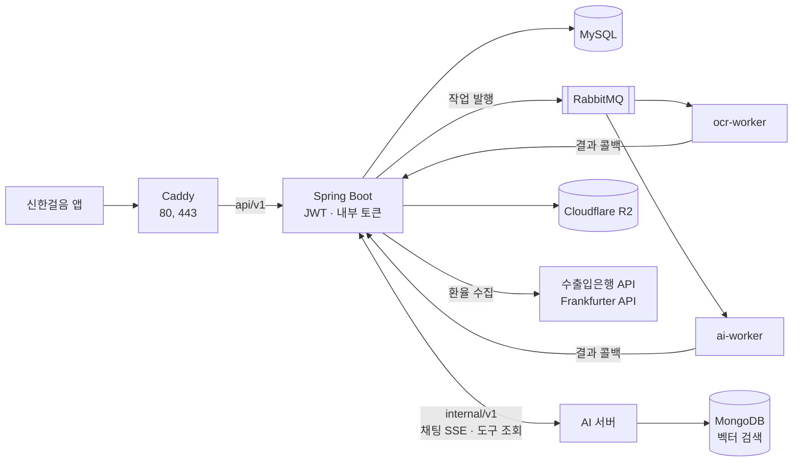

# hanstep-backend

신한커리어넥스트 2회차 프로젝트 | 국내 거주 외국인의 금융생활 및 체류자격 성장을 지원하는 AI 플랫폼 '신한걸음'의 백엔드 레포지토리입니다.

<div align="center">

<h3>금융의 첫걸음부터 성장의 다음 걸음까지</h3>

국내 거주 외국인을 위한 AI 금융 성장 지원 플랫폼 <b>신한걸음</b>의 API 서버


<sub>패키지 20개 &nbsp;·&nbsp; 테스트 750개 &nbsp;·&nbsp; 외부 API <code>/api/v1</code> &nbsp;·&nbsp; 내부 API <code>/internal/v1</code></sub>

</div>

<br>

앱이 호출하는 API 서버입니다. 사용자 데이터를 저장하고, 계산과 챗봇이 필요한 요청은 AI 서버로 넘깁니다. 로컬 인프라(MySQL, RabbitMQ, MongoDB)와 운영 배포 설정도 이 레포지토리에 있습니다.

| 레포지토리 | 역할 |
| --- | --- |
| [hanstep-frontend](https://github.com/hanstep-lab/hanstep-frontend) | 모바일 앱 (Expo / React Native) |
| **hanstep-backend** (여기) | API 서버 (Spring Boot), 로컬 인프라, 운영 배포 |
| [hanstep-AI](https://github.com/hanstep-lab/hanstep-AI) | AI 서버 (FastAPI), 챗봇, 계산 엔진, OCR |

서비스 소개, 팀 소개는 [조직 프로필](https://github.com/hanstep-lab)에 있습니다.

## 구조


<details>
<summary><b>아키텍처 다이어그램 보기</b></summary>

<br>



</details>

- 앱은 Spring의 `/api/v1`만 호출합니다. AI 서버는 외부에 열지 않습니다.
- Spring과 AI 서버는 `/internal/v1`로 서로 호출하며, 방향마다 다른 내부 토큰을 씁니다.
- 시간이 걸리는 작업(등록증 OCR, 정책 문서 적재)은 RabbitMQ로 보내고 Worker가 결과를 내부 API로 보고합니다.
- 모든 요청은 JWT로 인증하고, 금액과 점수는 AI가 아닌 서버 코드가 계산합니다.
- 환율은 수출입은행(USD 등)과 Frankfurter(PHP, ECB 참고값)에서 수집합니다.

### 등록증 OCR 흐름

업로드는 인식을 기다리지 않고 바로 응답하고, 결과는 앱이 주기적으로 확인해서 가져옵니다.

1. 앱이 등록증 사진을 올립니다.
2. Spring이 원본을 R2에 저장하고, 인식이 끝나기 전에 202로 응답합니다.
3. Spring이 RabbitMQ에 작업을 넣습니다. 큐에는 ID만 싣고 원본은 R2에 둡니다.
4. ocr-worker가 R2에서 원본을 읽어 필드를 추출하고 결과를 Spring에 전달합니다.
5. 앱이 결과를 확인하고, 사용자가 수정한 뒤 확정합니다.

발행에 실패한 작업은 60초마다 다시 발행하고, Worker 오류는 재시도한 뒤 DLQ로 보냅니다. 원본 보관 기한은 24시간이며 사용자가 확정하면 바로 삭제합니다.

## 기술 스택

| 구분 | 사용 |
| --- | --- |
| 언어, 프레임워크 | Java 21, Spring Boot 4.1 (Web MVC, Data JPA, Security, Validation, AMQP) |
| 데이터베이스 | MySQL 8.4 |
| 메시지 큐 | RabbitMQ 4 |
| 벡터 검색 | MongoDB Atlas Local 8.0 (AI 서버가 사용) |
| 파일 저장 | Cloudflare R2 (S3 호환) |
| 인증 | JWT (jjwt) |
| API 문서 | springdoc-openapi (Swagger UI) |
| 테스트 | JUnit, Testcontainers(RabbitMQ) |
| 배포 | Docker Compose, Caddy, GitHub Actions |

## 도메인

`src/main/java/com/hanstep/` 아래 패키지입니다.

| 패키지 | 내용 | 외부 API |
| --- | --- | --- |
| `auth` | SOL 진입 토큰을 받아 JWT 발급 | `/api/v1/auth` |
| `user` | 사용자 정보 | `/api/v1/users` |
| `onboarding` | 온보딩 단계 저장 | `/api/v1/onboarding` |
| `consent` | 마이데이터 동의 | `/api/v1/consents` |
| `document` | 외국인등록증 업로드, OCR 결과 확인·수정 | `/api/v1/documents` |
| `mydata` | 금융기관 연결, Mock 데이터 적재 | `/api/v1/mydata` |
| `goal` | 목표 | `/api/v1/goals` |
| `commitment` | 월별 필수 확보액, 송금 후보 | `/api/v1/commitments` |
| `finance` | 금융 분석 | `/api/v1/finance/analyses` |
| `product` | 금융상품 추천 | `/api/v1/finance/products` |
| `fx` | 환율 수집·조회, 목표 환율 알림 | `/api/v1/fx/rates`, `/api/v1/fx/alerts` |
| `transfer` | 해외송금 견적·실행 | `/api/v1/transfers` |
| `visa` | 비자 프로필, E-7-4 점수 진단, 체류자격 전환 로드맵 | `/api/v1/visa/*` |
| `credit` | 대안신용 사전진단, SOL 글로벌론 모의 한도 | `/api/v1/credit` |
| `chat` | 챗봇 세션, AI 답변 스트림 중계 | `/api/v1/chat/sessions` |
| `policy` | 정책 문서 등록·검수 | `/api/v1/admin/policy-documents` |
| `demo` | 데모 계정 초기화 | `/api/v1/demo` |
| `aicontext` | AI 서버가 읽는 사용자 맥락 | 내부 API만 |
| `aijob` | AI 작업 발행·재발행·상태 관리 | 내부 API만 |
| `common` | 보안, 오류 처리, 설정 | - |

전체 API는 실행 후 Swagger UI에서 확인합니다.

## 폴더 구조

```
src/main/java/com/hanstep/   애플리케이션 코드 (도메인별 패키지)
src/main/resources/          설정, 마이데이터 Mock 원본
src/test/                    테스트
db/init/                     스키마와 시드 (스키마 기준)
db/dev/                      개발용 Mock 환율 시드
deploy/                      운영 배포 (compose, Caddy, 마이그레이션)
docs/perf/                   성능 측정 기록
scripts/                     데모 준비, 측정 스크립트
docker-compose.yml           로컬 인프라
```

## 테스트

```powershell
./gradlew test        # 단위·통합 테스트 (Docker 필요)
./gradlew perfTest    # 적재 기준선 측정. Docker MySQL(3307)이 떠 있어야 함
```

2026.11.24 develop 브랜치 기준 테스트는 750개입니다.

### 메시지 큐 장애 검증

RabbitMQ를 끄고, Worker를 강제 종료하고, 실패를 일부러 일으켜 메시지 처리를 확인했습니다.

| 항목 | 결과 |
| --- | --- |
| 메시지 서버 중단 | RabbitMQ를 껐다 켠 뒤, 그동안 들어온 OCR 요청 10건 모두 전달 |
| 중복 처리 | 같은 법령을 5번 보내도 중복 저장 0회 |
| 등록 요청 응답 | 0.11초 (처리는 뒤에서) |
| 실패 후 재시도 | 저장소 장애를 주입했을 때 재시도 한 번에 복구. 재시도 간격 5 → 15 → 45초 |
| 끝까지 실패한 메시지 | 버리지 않고 DLQ에 보관 |

남은 과제: 5MiB 업로드는 순차 p95가 기준 대비 36% 느리고, 동시 10건이면 연결 풀이 약 30초 고갈됩니다.

## 배포

`develop` 브랜치에 push하면 GitHub Actions(`deploy-prod`)가 운영 서버에 배포합니다. 서버 구성과 절차는 [deploy/README.md](deploy/README.md)에 있습니다.

## 로컬 실행

### 준비
- JDK 21, Docker Desktop
- `.env.example`을 복사해 `.env`를 만들고 값을 채운다.

### 실행
```powershell
docker compose up -d      # MySQL(3307), RabbitMQ, MongoDB 실행
./gradlew bootRun         # 또는 IntelliJ에서 HanstepBackendApplication 실행
```

### 공통 규칙
- 외부 API: `/api/v1`, 내부 API(AI 서버용): `/internal/v1`
- 오류 응답: `{ code, message, details, requestId }`
- 스키마 기준: `db/init/*.sql`

### 인증 (앱인앱 진입)
- 자체 로그인 없음. `POST /api/v1/auth/entry` 에 SOL 진입 토큰을 보내 JWT를 받는다. 데모 토큰: `demo-e9-ph-reyes` (`db/init/03_hanstep_demo_seed.sql`)
- 이후 요청은 `Authorization: Bearer {accessToken}`. 만료(기본 1시간) 시 401 → 다시 `/auth/entry`
- `.env`에 `JWT_SECRET`이 없으면 서버가 시작되지 않는다. 만드는 방법은 `.env.example` 참고
- Swagger: http://localhost:8080/swagger-ui.html → Authorize 버튼에 accessToken 입력

### 데모 데이터 준비
- Spring(`bootRun`)과 AI 서버를 띄운 뒤 `powershell -ExecutionPolicy Bypass -File scripts\demo-setup.ps1` 실행
- 데모 사용자로 진입 → 마이데이터 동의 → 신한은행·신한카드 연결·Mock 적재 → 필수 확보액·목표 저장 → 금융 분석까지 한 번에 한다
- 다시 실행해도 된다(409 는 건너뜀). 단계별 성공 여부와 사용자 id, 여유자금·변동지출만 출력한다

### AI 서버 연동 (내부 API)
- AI → Spring(`/internal/v1/**`): AI가 `X-Internal-Token: {SPRING_INTERNAL_API_KEY}`를 보낸다
- Spring → AI: `aiRestClient` 빈이 `AI_INTERNAL_API_URL`(기본 `http://localhost:8000`)로 `X-Internal-Token: {AI_INTERNAL_API_TOKEN}`, `X-Request-Id`를 붙여 호출한다
- 두 키 모두 AI 서버 `.env`와 같은 값, 32자 이상. 방향마다 다른 값을 쓴다. `AI_INTERNAL_API_TOKEN`이 없어도 서버는 뜨지만 시작 로그에 경고가 남고 AI 호출은 401
- 챗봇 요청(INT-05 `POST /internal/v1/agent/chat/stream`) 본문: `runId`·`userId`·`sessionId`·`language`(`users.preferred_language`)·`nationalityCode`(`visa_profiles.nationality_code`, ISO 3166-1 alpha-3, 예: `PHL`. 비자 프로필이나 값이 없으면 null)·`history`(최근 완성 3쌍)·`message`. AI는 모르는 필드를 거부하므로 필드를 더할 때는 AI를 먼저 배포한다(`nationalityCode`는 hanstep-AI #130)
